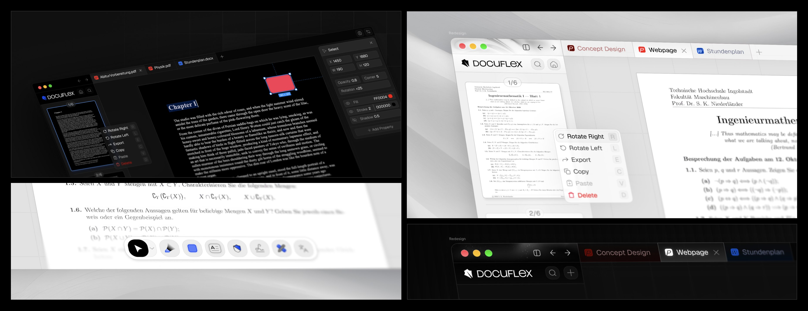

<p align="center">
  
</p>
<p align="center">
  
</p>

<h1 align="center">Docuflex: Free PDF Editor (Desktop/Website)</h1>

<p align="center">
  <strong>Edit, sign, convert and redact PDFs for free. No account, no ads, no subscription. Open source. All local.</strong>
</p>

<p align="center">
  <a href="https://docuflex.eu"><strong>Use it online at docuflex.eu</strong></a>
  &nbsp;·&nbsp;
  <a href="https://github.com/max06bayer/docuflex/releases/latest"><strong>Download for macOS, Windows and Linux</strong></a>
</p>

> [!NOTE]
> **Docuflex is in beta.** It is usable for everyday work, but it still has bugs and some features are unfinished. Keep a copy of important files, and please [report problems](https://github.com/max06bayer/docuflex/issues).

## Highlights

- **Real text editing.** Change the text that is already in the PDF, in its own font and layout, instead of covering it with a new text box.
- **Edit-protected PDFs.** When a PDF's owner blocks editing but allows printing, Docuflex makes an editable copy for you, the same thing "Print to PDF" produces.
- **Photo and scan editor.** Straighten crooked scans and fix exposure, contrast, color and sharpness, then run OCR to make them searchable and selectable.
- **Signatures from your camera.** Hold your signature on paper up to the camera, and Docuflex cuts it out and places it on the page.
- **Built-in AI, with your own key.** Ask the AI to summarize, fill out forms, highlight, rewrite or redact. Bring your own [OpenRouter](https://openrouter.ai) key and pick the model; on the desktop, other AI apps can drive Docuflex through its MCP server.
- **Irreversible redaction.** Blackout and whiteout destroy the text and pixels underneath when you save. Nothing can be copied or recovered from the saved file.
- **Everything else you need:** merge, split, compress, convert to and from Word, translate, protect with a password, flatten, watermark, forms, comments, shapes, drawing and measuring, and so much more.

## How it compares

| | **Docuflex** | Adobe Acrobat Pro | Foxit PDF Editor | PDF Expert | Smallpdf | PDFgear |
|---|:---:|:---:|:---:|:---:|:---:|:---:|
| **Price** | **Free** | $19.99/mo (annual) | $129.99/yr | $79.99/yr | about $9–15/mo | Free |
| **Subscription or Pro tier** | **None** | Yes | Yes | Yes | Yes | None |
| **Edit existing text** | ✅ | ✅ | ✅ | Paid | Paid | ✅ |
| **OCR for scans** | ✅ | ✅ | ✅ | Paid | Paid | ✅ |
| **Permanent redaction** | ✅ | ✅ | ✅ | Paid | Limited free | ✅ |
| **AI assistant** | ✅ | Paid add-on | Paid add-on | Limited free | Paid | ✅ |
| **AI with your own key** | ✅ | ❌ | ❌ | ❌ | ❌ | ❌ |
| **Works offline** | ✅ | ✅ | ✅ | ✅ | ❌ | ✅ |
| **No account needed** | ✅ | ❌ | ❌ | ❌ | ❌ | ✅ |
| **Open source** | ✅ | ❌ | ❌ | ❌ | ❌ | ❌ |

<sub>Paid: needs the paid plan or an add-on. US list prices for individual plans as of October 2026; they vary by region and promotion.</sub>

## Get Docuflex

| Platform | Download |
|---|---|
| **Web** | [docuflex.eu](https://docuflex.eu), nothing to install |
| **macOS** (Apple Silicon) | `Docuflex_<version>_macOS_arm64.dmg` |
| **Windows** (x64) | `Docuflex_<version>_x64-setup.exe` |
| **Linux** (x64) | AppImage, Arch package (`.pkg.tar.zst`), Debian package (`.deb`, untested) |

All installers are on the [latest release](https://github.com/max06bayer/docuflex/releases/latest) page. The desktop app works offline: OCR, conversion and translation run on your computer.

## Privacy

Docuflex is designed to keep your documents to yourself. The desktop app does everything on your computer and sends no analytics. The website processes files only for the action you ask for, never sends them to third-party services, and uses only cookie-free analytics that store no IP addresses.

See **Settings → Legal & Privacy** in the app for operator and privacy details.

## Technology

- [SvelteKit](https://svelte.dev/docs/kit) and Svelte 5
- [PDF.js](https://mozilla.github.io/pdf.js/) for rendering and text layers
- Java and [Apache PDFBox](https://pdfbox.apache.org/) for native PDF operations
- [Tauri](https://tauri.app) for the desktop app
- Local tools for conversion, OCR, compression and translation

## Development

Requirements: Node.js 20 or newer, npm, a JDK for PDF backend work, and optional local document tools for conversion and OCR.

```bash
npm install
npm run dev
```

Run the PDF backend in a second terminal when working on backend-powered tools:

```bash
npm run backend:dev
```

Check a change before submitting it:

```bash
npm run check
npm run build
```

Desktop builds are described in [desktop/README.md](desktop/README.md), and releases in [RELEASING.md](RELEASING.md).

## Contributing

Bug reports and focused improvements are welcome. The project moves quickly, so please open an issue before starting a large change.

## License

Docuflex is free and open-source software licensed under the [GNU Affero General Public License version 3.0 only](LICENSE) (`AGPL-3.0-only`). You may use, modify and redistribute it, including commercially, under the license's terms. If you modify Docuflex and make that version available to users over a network, you must offer those users the corresponding source code as required by the AGPL.

Third-party components remain governed by their own licenses.

Copyright 2026 Maximilian Bayer.
